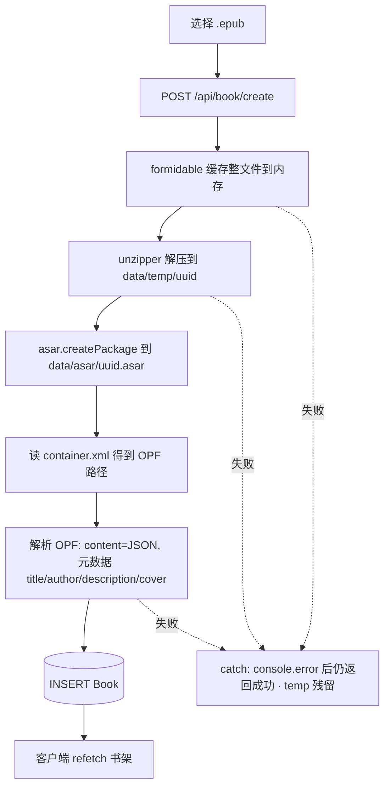
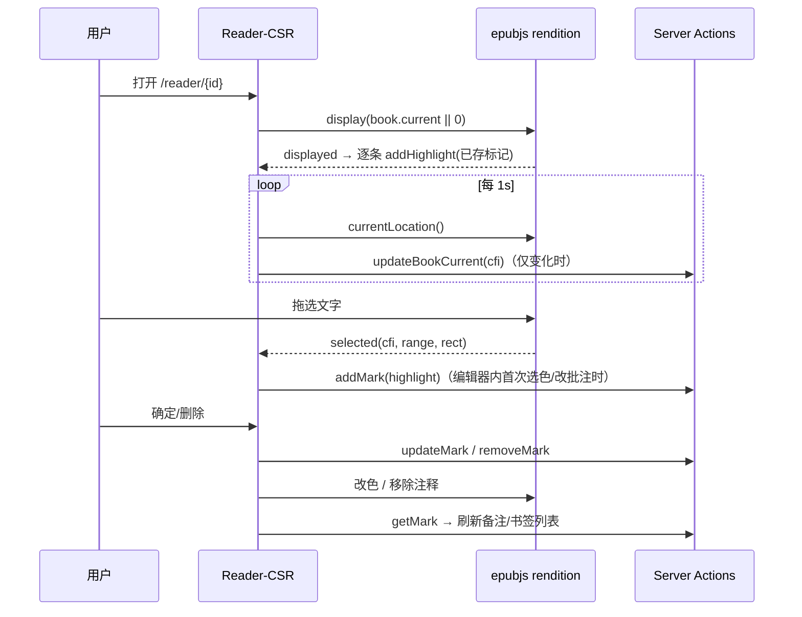

# Beryllium 功能对齐 PRD（重构基线）

| 项   | 内容                                                                                                   |
| ---- | ------------------------------------------------------------------------------------------------------ |
| 版本 | v1.0                                                                                                   |
| 日期 | 2026-10-13                                                                                             |
| 状态 | 重构前功能基线，待评审                                                                                 |
| 目的 | 在重构开始前，把**当前实现的真实行为**冻结成可对账的规格：功能范围、交互细节、边界、已知缺陷与验收清单 |
| 读者 | 参与重构的开发、评审、验收者                                                                           |

> 本文描述的是**现状**（as-is），包含已知缺陷。凡标记 `D#` 的行为都是缺陷/技术债，重构时需显式决策「修复」或「保留」，不能默默改变。

## 0. 证据来源

- 源码：`src/**`、`prisma/**`、`public/epub/rendition-injection.js`（文中以路径引用）。
- 实测：本机 dev server `http://localhost:3001`（Next dev，`pnpm dev`），登录 `admin / admin123`；上传自建样例 epub（EPUB3 + NCX，含嵌套目录、封面图、章内图片、章内链接）。
- 数据核验：直接查询 `data/db.sqlite`（Prisma）与 `data/asar/`、`data/temp/` 目录。
- 未实测项集中在 §11，均已标注 `[未验证]`。

## 1. 产品概述

- **定位**：自部署（self-hosted）的在线 EPUB 阅读器，一个 Docker 镜像 + 一个数据卷即可运行。
- **形态**：Web（桌面 + 移动浏览器），无原生客户端、无 CLI。
- **多用户**：单实例多账户，数据按用户隔离；首个管理员由环境变量在启动时创建。
- **核心能力**：书籍上传（EPUB → ASAR）、书架与分类管理、在线阅读（分页渲染、目录跳转、进度记忆）、高亮与书签、主题切换（含阅读器内主题）、移动端适配。
- **明确不在范围内**：书城/下载、社交、云同步、跨实例联邦、OCR/全文检索、阅读排版设置（字号/行距/字体）、导出。
- **技术栈现状**（重构时的迁移对象）：Next.js 14 App Router + Pages API（`src/pages/api`）、Prisma + SQLite、iron-session、TanStack Query、Jotai、MUI v5 + tss-react、epubjs 0.3.88、formidable、asar/asar-async、unzipper。

## 2. 角色与权限

| 能力                                     | 未登录                                                                                                    | 普通用户                                | 管理员                                                 |
| ---------------------------------------- | --------------------------------------------------------------------------------------------------------- | --------------------------------------- | ------------------------------------------------------ |
| 访问 `/login`                            | ✅                                                                                                        | ✅（不自动跳转，见 D7）                 | ✅                                                     |
| `/bookshelf`、`/reader/[id]`、`/setting` | ❌ 307→`/login`（`auth()`，`src/server/wrapAppRouter.ts`；实测响应含 `NEXT_REDIRECT;replace;/login;307`） | ✅                                      | ✅                                                     |
| 书籍/标记/分类 CRUD                      | ❌                                                                                                        | ✅ 仅自己的（`userId` 过滤 + 归属校验） | ✅                                                     |
| 修改自己的密码                           | ❌                                                                                                        | ✅（当前实现有缺陷 D2）                 | ✅                                                     |
| 用户列表 / 新增用户 / 删除用户           | ❌                                                                                                        | ❌（不渲染该卡片）                      | ✅（`isAdmin` 为 true 时，`src/app/setting/page.tsx`） |
| 主题模式                                 | —                                                                                                         | ✅                                      | ✅                                                     |

- 管理员同时是普通用户（有自己的书架）；无法通过 UI 删除或降级管理员账号；没有注册页，账户只能由管理员创建。
- 会话是**单 cookie（`sealed`）**：同一浏览器内多标签共享一个身份；一处退出登录，其它标签的会话同时失效（实测）。

## 3. 页面与路由地图

| 路由                                            | 类型                                   | 守卫                                 | 关键内容                                                                                                            |
| ----------------------------------------------- | -------------------------------------- | ------------------------------------ | ------------------------------------------------------------------------------------------------------------------- |
| `/`                                             | 重定向                                 | —                                    | 308 → `/bookshelf`（`next.config.mjs` redirects）                                                                   |
| `/login`                                        | RSC + CSR 表单                         | 无                                   | 用户名 + 密码；Formik + zod 校验；提交后 `router.push("/bookshelf")`                                                |
| `/bookshelf`                                    | RSC 页壳 + CSR 主组件                  | `auth()`                             | 书架：上传、书卡菜单、分类、主题、设置、退出                                                                        |
| `/reader/[id]`                                  | RSC（服务端取书/TOC/标记）+ CSR 阅读器 | `auth()` + 书籍归属                  | epubjs 渲染、目录/备注/书签抽屉、进度上报、图片预览                                                                 |
| `/setting`                                      | RSC（按 `isAdmin` 取用户列表）+ CSR    | `auth()`                             | 修改密码卡片；（管理员）用户卡片                                                                                    |
| `POST /api/book/create`                         | Pages API                              | `withSessionRoute` → 未登录 401 JSON | `multipart/form-data` 上传 EPUB（`bodyParser: false`）                                                              |
| `GET /api/book/file/[fileName]/[...path]`       | Pages API                              | `withSessionRoute` → 未登录 401 JSON | 从 ASAR 读取任意内部文件，按扩展名推断 MIME，`Cache-Control: private,max-age=31536000,immutable`，缺失返回 404 空体 |
| 边界：`/reader/{id}` 中 `id` 不存在或非本人书籍 | —                                      | —                                    | 服务端 `redirect("/bookshelf")`（实测 `/reader/999`）；未登录则先跳 `/login`                                        |

## 4. 数据模型与存储

### 4.1 数据库（SQLite，`prisma/schema.prisma`）

| 模型           | 字段（语义）                                                                                                                                                                                                                     |
| -------------- | -------------------------------------------------------------------------------------------------------------------------------------------------------------------------------------------------------------------------------- |
| `User`         | `id`、`username`（唯一）、`password`（**sha256 十六进制**，`src/server/service/user.ts#getPasswordHash`）、`isAdmin`                                                                                                             |
| `Book`         | `id`、`title`、`author`、`description`、`cover`（ASAR 内相对路径）、`fileName`（= ASAR 文件名，uuidv1）、`contentPath`（OPF 路径）、`current`（阅读进度 CFI 字符串）、`content`（解析后的 OPF XML 以 JSON 字符串存放）、`userId` |
| `Mark`         | `id`、`type`（`"bookmark"` \| `"highlight"`，`src/utils/constants.ts`）、`epubcfi`、`color`（7 个枚举色名）、`title`、`content`（批注正文）、`selectedString`（选中原文）、`bookId`、`userId`                                    |
| `Category`     | `id`、`name`、`userId`                                                                                                                                                                                                           |
| `CategoryBook` | `id`、`bookId`、`categoryId`（多对多连接表，**无唯一约束**，见 D9）                                                                                                                                                              |

- Prisma 客户端有两条 `$extends`：`Book.contentObject`（`content` JSON.parse）与 `Book.contentMetadata`（`contentObject.package.metadata[0]`），供 `src/server/db.ts` 内解析元数据使用。
- 上传时写入的 `title/author/description/cover` 取自 OPF 元数据（`fillInBaseInfo`）：`dc:title`、`dc:creator`、`dc:description`，封面优先 `<meta name="cover">` → manifest item；**无 `<meta name="cover">` 的书封面为空**。
- 无数据库级外键级联：删除用户/书籍/分类的级联由应用代码手写（`src/server/service/user.ts#deleteUser`、`src/app/bookshelf/actions.ts`）。

### 4.2 文件布局

```
data/
  db.sqlite            # DATABASE_URL=file:../data/db.sqlite
  asar/<fileName>.asar # 每本书一个 ASAR（= EPUB 解压后的文件树，未压缩语义）
  temp/<uuid>/         # EPUB 解压中间目录，成功后被 rimraf 删除（失败会残留，见 D5）
```

- 原始 `.epub` **不保留**（上传后即丢弃，README 已声明）。
- ASAR 内的文件通过 `readAsarFile` 读取，实例由 LRU 缓存（`max: 500`，`allowStale`，`src/server/service/file.ts`）。
- 已知环境现象：`data/asar/` 存在 3 个 2023 年的**孤儿 asar**（数据库无对应 `Book`），说明历史上删除路径有过不一致，重构时可加入孤儿清理。

## 5. 功能规格

### 5.0 启动引导

- 服务进程启动时（`src/instrumentation.ts` → `src/firstStartup.ts`）检查是否存在 `isAdmin` 用户；不存在则以 `ADMIN_USER_NAME` / `ADMIN_USER_PASSWORD` 创建。
- 因此 `ADMIN_USER_*` 只在**首次**创建库时生效（README 已说明）。`prisma/seed.mjs` 提供等价的种子脚本（不存在管理员时创建 `admin/admin`）。
- 环境变量（`src/env.mjs` 校验）：`DATABASE_URL`、`ASAR_DIR`、`TEMP_DIR`、`ADMIN_USER_NAME`（≥1）、`ADMIN_USER_PASSWORD`（≥6）、`SESSION_SECRET`（≥32）。`SKIP_ENV_VALIDATION=true` 可跳过校验（Dockerfile 构建时使用）。

### 5.1 认证

- **登录**：`/login`，Formik + zod（`username`/`password` 均非空）。服务端 `loginAction`（`src/app/login/actions.ts`）按 `username + sha256(password)` 查库，命中则写 iron-session（只存 `user.id`），失败抛 `RequestError("email or password may not be correct")`。
- 登录成功后 `router.push("/bookshelf")`；页面挂载时预取 `/bookshelf`。
- 登录失败：**界面无任何提示**（错误未捕获，只有 console 未处理拒绝）→ D4。
- **登出**：书架抽屉「退出登陆」→ `logout()` 销毁会话 → 跳 `/login`（`src/app/bookshelf/drawer.tsx`）。
- 服务端守卫：RSC 页面用 `auth()`（未登录 `redirect("/login")`）；Pages API 用 `withSessionRoute`（未登录 `401 {isSuccess:false,message:"Unauthorized"}`）。
- 密码策略：登录侧无长度/复杂度限制；新增用户与改密由服务端 zod 要求 ≥6 位（§5.6）。

### 5.2 书架（`/bookshelf`）

**布局**：左侧固定 Drawer（≥`sm`）/ 汉堡抽屉（<`sm`）；顶栏标题「书架」、主题按钮；主区为书卡网格。

- 抽屉条目：`我的书籍`（= 全部书）、`分类` 分组（每分类一项，点击即筛选）、`创建分类`、`设置`、`退出登陆`。
- **上传**：网格首位的「+」卡片（无分类被选中时才出现）点击后打开系统文件选择，`accept="application/epub+zip"`；选中即上传，并在右上角弹**常驻成功样式** snackbar「正在上传文件，请不进行其他操作」，完成后关闭并刷新列表（`handleSelectFile`）。
- **书卡**：封面（`next/image`，当前恒失败 → D1）、标题、作者（来自 OPF 元数据）；整卡点击进入 `/reader/{id}`。
- **书卡菜单（⋮）**：
  - `添加到分类`：打开「选择类别」对话框，列出**除当前分类外**的分类；无候选时 snackbar「暂无其他类别，请添加后重试！」。
  - `从分类中删除`：仅在某分类被选中时出现；确认对话框「移除书籍 / 是否从当前分类中移除书籍？」。
  - `删除书籍`：确认对话框「删除书籍 / 删除书籍会移除书籍相关标记和书签」；确认后删除书籍记录、其所有 `Mark`、`CategoryBook` 关联与 ASAR 文件（实测：DB 与磁盘均清理）。
- **分类**：`创建分类` → 对话框「添加类别 / 输入类别名称」；创建后出现在抽屉。选中分类后：主区只显示该分类书籍、「+」卡片消失、顶栏出现 ⋮ 菜单（`删除类别`，确认「删除分类 / 是否删除当前分类？」），删除后自动回到 `我的书籍`。
- 空状态：无书籍时仅有「+」卡片；无分类时抽屉不显示分类项。
- 列表数据由 react-query 维护（`["getBook"]`、`["getCategory"]`），操作成功后显式 `refetch`；初值为空数组再客户端拉取（无 SSR 数据）。

### 5.3 上传与转换管线

1. 浏览器 `POST /api/book/create`（FormData，字段名 `file`）。
2. 服务端 `formidable` 接管，`form.onPart` 把所有文件分片的 `data` **拼进内存 Buffer**，`form.parse` 后转成 `Readable`。
3. `saveEpubFile`：生成 `uuidv1` 文件名 → `unzipper.Parse` 解压到 `temp/<uuid>/`（含目录条目）→ `asar.createPackage` 打包到 `asar/<uuid>.asar` → 删除临时目录。
4. 读 `META-INF/container.xml` 取 OPF 路径 → 读 OPF → 存 `content`（JSON 字符串）+ 补齐元数据 → 建 `Book` 行。
5. 响应恒为 `{isSuccess: true, data: null}`。
6. 失败处理：服务端 `catch` 后仅 `console.error`，**仍返回成功**，界面无失败提示（实测：上传非 zip 内容 → 无提示、书不出现、`temp/` 残留目录）→ D5。

### 5.4 阅读器（`/reader/[id]`）

**服务端**（`src/app/reader/[id]/page.tsx`）：校验书籍归属（否则 `redirect("/bookshelf")`）；解析 TOC；按 `type` 分组取该书的 `Mark`，把 `highlights`、`bookmarks`、`tocData`、`current` 传给客户端。

**渲染内核**（`src/utils/epubReader.ts` 封装 epubjs）：

- `ePub(opfUrl)`，`renderTo("viewer", { manager: "continuous", flow: "paginated", width/height: "100%", snap: true, allowScriptedContent: true, script: "/epub/rendition-injection.js" })`。
- 对外事件：`selected`（选区→CFI）、`markClicked`（点击高亮 SVG）、`relocated`（位置变化）、`displayed`。
- 主题通过 `rendition.themes.register/select` 注入（`light` 空对象、`dark` 仅 `body{color:white}`）。
- 调试钩子：`window.epubReader = 实例`（源码保留）。

**交互**：

| 交互     | 行为                                                                                                                                                       |
| -------- | ---------------------------------------------------------------------------------------------------------------------------------------------------------- |
| 首次显示 | `display(book.current                                                                                                                                      |     | 0)`，即恢复上次 CFI；无进度从书首开始 |
| 翻页     | 桌面（≥`sm`）：左右两侧悬浮箭头；`xs` 下隐藏（靠滑动/键盘）；`next()/prev()`，翻页前关闭高亮编辑器                                                         |
| 目录     | 「目录」页签为嵌套列表，支持展开/折叠子节点；点击项 → `display(src)`；当前章节按 `relocated.start.href` 自动高亮（实测：跳转与高亮同步）                   |
| 进度上报 | 每 **1 秒**轮询 `currentLocation()`，CFI 变化时调用 `updateBookCurrent` 写库（实测：刷新后恢复到同一位置）                                                 |
| 书签新增 | 顶栏书签按钮 → 取当前位置 CFI、向上回溯 DOM 得到标题（`getElementHeading`）、`lodash/truncate` 截断选中文字 → 打开「书签标题」对话框（预填标题）→ 确定写入 |
| 返回书架 | 顶栏返回箭头 → `router.push("/bookshelf")`，并立即上报一次进度                                                                                             |
| 图片预览 | 章内 `` 点击 → iframe 内注入脚本调用 `window.top.$$openImagePreview(src)` → react-photo-view 全屏查看（实测可用）                                     |
| 屏幕常亮 | 阅读器挂载时 `navigator.wakeLock.request("screen")`，`visibilitychange` 恢复，卸载释放（`useScreenWakeLock`）                                              |

**目录解析现状**（`src/server/service/epub.ts` + `src/server/db.ts#getTocPath`）：

- 只解析 **NCX**（`navMap/navPoint`，支持嵌套），显式 `todo: support epub3 Navigation Document`；`getTocPath` 依赖 `spine[toc]` 属性，注释亦标 `todo: support epub3 toc`。
- 纯 EPUB3（无 NCX）书籍在取 `href` 处会失败 → D8（本次测试用书自带 NCX，故未触发）。

**已知的注入脚本副作用**：`public/epub/rendition-injection.js` 对 iframe 内**所有** `click` 调用 `preventDefault()`，只在 `IMG` 上转发预览。因此书内**超链接/脚注/内部跳转全部失效**（实测：点击章内 `<a href="chapter2.xhtml">` 无反应）→ D6。

### 5.5 标注（高亮 / 书签）

**高亮**

- **创建路径（源码为准；端到端创建受环境限制，见 §11）**：在正文拖选文字 → epubjs `selectionchange`（250ms 防抖）→ rendition `selected` → 应用算出的矩形（iframe 偏移修正）锚定 Popper，弹出 `HighlightEditor`。编辑器初始态为「无 id、颜色空」，且**颜色选择是唯一能创建标记的动作**：
  - 单选颜色 → `onChange` → 因无 `id` 立即调用 `addMark` 落库并回填 `id`（此时标记已存在于服务端）。
  - 「评论」输入框在新标记时 `disabled={!props.id}`，即**必须先选色才能输入批注**。
  - `确定` 仅在已有 `id` 时执行 `updateMark`；无 `id` 时直接返回（不创建）。
  - `取消` 只关闭编辑器（并尝试还原内存中的高亮样式），**不会回滚已入库的新标记或已生效的颜色**。
  - `删除` 在无 `id` 时直接返回（不产生请求）。
  - 复现要点：新标记若只点「确定」而不选色/不改批注，服务端不会产生任何记录。
- **编辑既有高亮**：点击正文中的高亮（SVG `g[data-epubcfi]`）→ 顶 document 的 `markClicked` → Popper 定位到该 SVG，编辑器载入该 `Mark` 的 `color/content`。
- **编辑器内容**：7 色单选（red/purple/blue/cyan/teal/orange/blue-grey，对应固定 hex；`color` 非法时 `fill` 为 undefined）、`multiline` 批注输入框（placeholder「评论」）、按钮 `取消` / `删除` / `确定`（顺序：确定 / 删除 / 取消，右对齐）。
- **确定** → `updateMark`（含颜色与批注）→ 同步 DOM 颜色 → 关闭 → 刷新「备注」列表。
- **删除** → `removeMark` + 移除正文注释 + 刷新列表（实测：DB 行与正文 SVG 同时消失）。
- **渲染**：高亮是顶 document 上的 SVG 覆盖层（`g[data-epubcfi][data-color][fill]`），由 `rendition.annotations.highlight(epubcfi, {id,color}, ..., {fill})` 生成。
- 选中文字变化会关闭编辑器（编辑器打开时注册的 `selectionchange` 监听）；移动端虚拟键盘弹出时会把 Popper 重新锚定到视口底部（`navigator.virtualKeyboard`）。

**书签**

- 「书签」页签列表项：标题、`selectedString`、右侧 ⋮ 菜单（`修改标题` / `删除`）。
- 列表项点击 → `display(epubcfi)` 跳转（实测：列表点击跳转可用）。
- `修改标题` → 复用「书签标题」对话框（预填当前标题）→ `updateMark` → 列表刷新（实测成功）。
- `删除` → `removeMark` → 列表刷新（代码同高亮删除路径）。

**列表**

- 「备注」页签列出该书所有高亮：标题、选中原文、`批注 {content}`（无批注则隐藏该行）、⋮ 菜单（仅 `删除`）。
- 两类列表都由父组件传入 react-query 数据，变更后 `refetch`；服务端动作都会做 `userHasMark` / `userHasBook` 归属校验，失败抛 `RequestError`。

### 5.6 设置（`/setting`）

- **修改密码卡片**：`新密码`、`再次输入` 两个输入 + `确认`。
  - 服务端 `changePassword` 仅校验 `z.string().min(6)`，**直接以明文覆盖 `User.password`**（未 hash）→ 之后无法用新密码登录（登录按 sha256 比对）→ **D2**（实测：改密后 DB 存 `newpass99`，登录失败）。
  - `再次输入` **没有任何一致性校验**（实测：两栏不一致也能提交成功）→ D3。
- **用户卡片（仅管理员）**：
  - `添加新用户`：用户名（≥1）+ 密码（≥6）→ `addUser` → 刷新 RSC 列表（实测：DB 中密码为 sha256）。
  - 用户表：`ID / 用户名称 / 管理员`；非管理员行有删除按钮 → 确认对话框「删除用户 / 是否删除{username}?」→ `removeUser`（级联删除其书籍、标记、分类与 ASAR 文件）→ 刷新（实测成功）。
- 无「修改用户名」、无「提升为管理员」、无密码强度策略。

### 5.7 主题、响应式与移动端

- 主题模式三态：`auto`（跟随系统 `prefers-color-scheme`）/ `dark` / `light`（`ThemeMode`）；由顶栏按钮弹出的菜单选择，当前态在该菜单中禁用。
- 持久化：`localStorage["theme"]`；并监听 `storage` 事件做跨标签同步（`src/store/theme.ts`）。
- MUI 主题在 `AppProvider` 中创建（背景/文字色）；阅读器把 `dark|light` 传给 epub 内容主题（仅设置 `body{color:white}`，实测正文变白）。
- 响应式断点：抽屉用两组 `Hidden` 切换——`xs`（<600px）用可滑动临时抽屉（书架靠汉堡按钮、阅读器靠顶栏菜单图标打开），`sm`（≥600px）起显示常驻抽屉（书架 300px、阅读器 340px）；阅读器左右翻页箭头仅在 `xs` 隐藏（`up("sm")` 显示，实测 390px 隐藏 / 800px 与 1280px 显示）。
- 虚拟键盘：使用 `navigator.virtualKeyboard.overlaysContent`（支持的浏览器）避免输入框被键盘遮挡，并把高亮编辑器抬到键盘上方。
- 遗留死代码：阅读器抽屉底部还有一个 `SwipeableDrawer`（`bottomDrawerOpen`，内容为占位文字 `test3`，源码 `src/app/reader/[id]/readerDrawer.tsx`）→ D10。

### 5.8 提示与错误处理约定（现状）

- snackbar（notistack）：上传开始提示；操作成功提示（分类添加）；服务端动作返回 `{isSuccess:false,message}` 时由 `requestAction` / `get` / `post` 统一弹出 error snackbar（`src/utils/request.ts`）。
- 确认对话框：`useConfirmDialog`（Promise 语义，取消 = reject）——用于删除书籍/分类/移除分类/删除用户。
- 服务端动作统一信封：`{isSuccess, data, message?, error?}`；未登录返回 `{isSuccess:false,message:"Unauthorized"}`；`ZodError` 与 `RequestError` 的 message 会透传到客户端。
- 缺口：登录失败静默（D4）、上传失败静默（D5）、阅读器内不弹任何错误提示。

## 6. 关键流程





## 7. 接口与动作清单

**Server Actions**（`"use server"`，信封见 §5.8）

| 文件                             | 动作                                                                                                                                         | 说明                                          |
| -------------------------------- | -------------------------------------------------------------------------------------------------------------------------------------------- | --------------------------------------------- |
| `src/app/login/actions.ts`       | `loginAction`                                                                                                                                | 校验账号密码并写会话                          |
| `src/app/bookshelf/actions.ts`   | `getBook` / `getCategory` / `createCategory` / `removeCategory` / `addBooksToCategory` / `removeBooksFromCategory` / `deleteBook` / `logout` | 书架数据与分类管理；`logout` 销毁会话         |
| `src/app/reader/[id]/actions.ts` | `getMark` / `addMark` / `updateMark` / `removeMark` / `updateBookCurrent`                                                                    | 均做归属校验（`userHasBook` / `userHasMark`） |
| `src/app/setting/actions.ts`     | `addUser` / `removeUser` / `changePassword`                                                                                                  | 见 D2/D3                                      |

**HTTP API**

| 方法/路径                                 | 入参             | 出参                         | 备注                                                                                |
| ----------------------------------------- | ---------------- | ---------------------------- | ----------------------------------------------------------------------------------- |
| `POST /api/book/create`                   | multipart `file` | `{isSuccess:true,data:null}` | 失败也返回成功（D5）                                                                |
| `GET /api/book/file/{fileName}/{...path}` | 路径             | 二进制                       | MIME 按扩展名推断；`private,immutable` 缓存头；未登录 401 JSON；文件不存在 404 空体 |

**客户端库**：`src/clientApi.ts`（`uploadBook`、`getFileUrl`）、`src/utils/request.ts`（`get/post/requestAction` 统一错误提示）。

## 8. 非功能需求与约束

- **部署**：单容器（Dockerfile：next standalone + Prisma migrate deploy + 全局 prisma CLI），数据卷挂 `/app/data`；默认端口 3000；`ADMIN_USER_*` 仅首次生效。镜像构建支持 amd64/arm64（`.github/workflows/docker-image.yml`，仅 tag 触发）。
- **网络与会话**：`iron-session` cookie 名 `sealed`，`SESSION_SECRET` ≥32 字符；`cookieOptions.secure=false` 为兼容 HTTP 部署（生产 HTTPS 环境需另行使能，见 §11）。
- **数据隔离**：所有查询按 `session.user.id` 过滤；服务端动作额外做归属二次校验。
- **性能现状**：单本书上传统一内存缓冲（大文件风险，D5）；ASAR 读走进程内 LRU；阅读器进度写库频率上限 1 次/秒/标签；书架/阅读器页无分页（书籍数量大时全量渲染）。
- **可访问性/SEO**：MUI 语义标签基本到位（`nav`/`main`/`header`/`role=tab`）；无 SSR 内容（`NoSsr` 包裹），故无 SEO 诉求。
- **国际化**：界面文案为**简体中文硬编码**，无 i18n 框架；`<html lang="en">`（不改动的前提下重构应保持一致或同步调整）。
- **测试/质量门禁**：仓库**无测试框架、无 `test` 脚本**；CI 仅构建并推送镜像，不跑 lint/typecheck（`package.json` 提供 `lint`/`format`/`typecheck` 供手动执行）→ D11。

## 9. 已知缺陷与技术债（重构需显式决策）

> 复现环境：dev server `:3001`，登录 `admin`；样例 epub 见 §0。每条给出证据与影响。

| #   | 现象                                                                                                                                           | 位置                                                                                                                                                                                       | 证据                                                                                                                                                                                                                                                                                                                                       | 影响                                                                     |
| --- | ---------------------------------------------------------------------------------------------------------------------------------------------- | ------------------------------------------------------------------------------------------------------------------------------------------------------------------------------------------ | ------------------------------------------------------------------------------------------------------------------------------------------------------------------------------------------------------------------------------------------------------------------------------------------------------------------------------------------ | ------------------------------------------------------------------------ |
| D1  | **书架封面全部不显示**（显示 alt 文本）                                                                                                        | `src/app/bookshelf/bookList.tsx`（`next/image`）+ `src/pages/api/book/file/...`                                                                                                            | `/_next/image?url=/api/book/file/...` 返回 400 `The requested resource isn't a valid image.`；同 URL 直连（带 cookie）200 `image/png`；`/favicon.ico` 走优化器 200。根因：Next 优化器内部请求**不携带用户会话**（`node_modules/next/dist/server/image-optimizer.js#fetchInternalImage` 用 mock req 请求同源 API），受保护接口返回 401 JSON | 封面功能等于不可用（`Book.cover` 数据正常）                              |
| D2  | **修改密码后无法登录**                                                                                                                         | `src/app/setting/actions.ts#changePassword`                                                                                                                                                | 该动作直接把明文写入 `User.password`；登录用 sha256 比对。实测：改密为 `newpass99` → DB 存明文 → 用新密码登录失败                                                                                                                                                                                                                          | 用户被锁死（仅管理员可再建号规避）                                       |
| D3  | 「再次输入」不校验                                                                                                                             | `src/app/setting/setting.tsx`                                                                                                                                                              | 两栏填不同值仍提交成功（实测）                                                                                                                                                                                                                                                                                                             | 误输入导致 D2 类锁死                                                     |
| D4  | 登录失败无任何提示                                                                                                                             | `src/app/login/page.tsx`                                                                                                                                                                   | `await loginAction(...)` 未 catch；实测错误后停留 `/login`，无 snackbar/文案                                                                                                                                                                                                                                                               | 用户不知失败原因                                                         |
| D5  | 上传失败被吞、临时目录残留、文件全量入内存                                                                                                     | `src/pages/api/book/create.ts`、`src/server/service/file.ts`                                                                                                                               | 上传非 zip 内容：无提示、无书、`data/temp/<uuid>/` 残留（实测）；`cacheData = Buffer.concat([cacheData, chunk])` 逐块复制（O(n²) 字节拷贝）；`formidable({})` 用默认配置且 `onPart` 被整体接管，故未见应用层体积限制；多个文件分片会拼成单一流                                                                                             | 静默失败 + 大文件内存/CPU 风险                                           |
| D6  | **书内超链接/脚注/内跳转失效**                                                                                                                 | `public/epub/rendition-injection.js`                                                                                                                                                       | 脚本对 iframe 内所有 `click` `preventDefault()`，仅 `IMG` 转发预览；实测点击章内 `<a>` 无反应                                                                                                                                                                                                                                              | 引用型 EPUB 阅读体验受损                                                 |
| D7  | 已登录访问 `/login` 不跳转                                                                                                                     | `src/app/login/page.tsx`                                                                                                                                                                   | 实测仍显示登录页（可借此切换账号）                                                                                                                                                                                                                                                                                                         | 轻微体验问题                                                             |
| D8  | 仅支持 NCX 目录；纯 EPUB3（`nav.xhtml`）书籍存在失败路径                                                                                       | `src/server/service/epub.ts`、`src/server/db.ts#getTocPath`                                                                                                                                | 源码 `todo` 注释；`getTocPath` 依赖 `spine[toc]` 属性                                                                                                                                                                                                                                                                                      | 部分 EPUB3 书打开异常                                                    |
| D9  | 数据一致性靠手写级联；无唯一约束、无孤儿文件回收                                                                                               | `prisma/schema.prisma`、`src/server/service/user.ts`、`src/app/bookshelf/actions.ts`                                                                                                       | `CategoryBook` 无 `@@unique([bookId, categoryId])`；仓库内已存在 3 个孤儿 asar                                                                                                                                                                                                                                                             | 重复加分类可能产生重复行；磁盘垃圾累积                                   |
| D10 | 阅读器底部遗留调试抽屉（内容 `test3`）                                                                                                         | `src/app/reader/[id]/readerDrawer.tsx`                                                                                                                                                     | 源码裸 `SwipeableDrawer` + `<Box>test3</Box>`，`disableSwipeToOpen`                                                                                                                                                                                                                                                                        | 死代码，重构必须清理                                                     |
| D11 | 无自动化测试、CI 不做静态检查                                                                                                                  | `package.json`、`.github/workflows/docker-image.yml`                                                                                                                                       | 无 `test` 脚本/测试目录；CI 仅 build & push 镜像                                                                                                                                                                                                                                                                                           | 重构回归风险全靠人工                                                     |
| D12 | 为绕开阅读器 effect 双触发而全局关闭 StrictMode                                                                                                | `next.config.mjs`（`reactStrictMode: false`，注释「void reader effect triggered twice」）、`src/app/reader/[id]/epubReader.tsx`                                                            | 源码注释                                                                                                                                                                                                                                                                                                                                   | 隐藏了真实的 effect 依赖问题；重构应修因而非关开关                       |
| D13 | 阅读器对 epubjs 内部实现有直接依赖                                                                                                             | `src/utils/epubReader.ts#updateHighlight`                                                                                                                                                  | 直接操作 `(rendition.annotations as any)._annotations`、`g[data-epubcfi]`、`g.dataset`                                                                                                                                                                                                                                                     | 升级 epubjs 即破坏；重构需抽出适配层契约                                 |
| D14 | 会话/数据模型的杂项技术债                                                                                                                      | `src/store/theme.ts`（仅 localStorage，不落库）、`src/config.ts`（`secure:false`）、`src/components/*` 中 `any` 蔓延、`src/utils/request.ts#get` 导出后全仓库未被引用（死代码，实测 grep） | 源码                                                                                                                                                                                                                                                                                                                                       | 主题不跨设备；生产 HTTPS 需手动调整                                      |
| D15 | **高亮编辑器状态机语义不完整**：新标记只能靠「选色」创建（`确定` 在无 id 时无操作、批注框在无 id 时禁用、`取消` 不回滚已入库标记与已生效颜色） | `src/components/highlightEditor.tsx`（`disabled={!props.id}`）、`src/app/reader/[id]/epubReader.tsx#handleEditorChange/handleConfirm/handleEditorCancel`                                   | 源码逐行核对；`preEditorValue` 用 `useRef` 初始化后从未更新，取消路径的「还原」实际无效                                                                                                                                                                                                                                                    | 新建高亮的交互与用户预期不符；取消语义含糊（用户以为未保存，实际已落库） |

## 10. 重构功能对齐验收清单

重构后逐条验证；**A 类 = 必须保持行为一致**，**B 类 = 允许改进但不得功能倒退**。

### A. 行为等价（逐条实测）

- [ ] 未登录访问 `/bookshelf`、`/reader/1`、`/setting` → 跳 `/login`；未登录调 API → 401 JSON。
- [ ] `/` → 308 `/bookshelf`；`/reader/{不存在或他人书籍}` → `/bookshelf`。
- [ ] 首次启动（空库）自动创建 `ADMIN_USER_NAME`/`ADMIN_USER_PASSWORD` 管理员；已存在管理员时环境变量不生效。
- [ ] 管理员可见用户表并能新增/删除非管理员用户；普通用户看不到用户卡片且只能改自己密码。
- [ ] 上传合法 EPUB：出现「正在上传文件，请不进行其他操作」提示 → 书卡出现，标题/作者/描述取自 OPF，`data/asar/<uuid>.asar` 生成，`data/temp` 无残留。
- [ ] 分类全流程：创建 → 书籍加入（「添加成功」提示）→ 分类筛选（只剩该分类书、无「+」卡）→ 移出分类（确认框）→ 删除分类（确认框，回到「我的书籍」）。
- [ ] 删除书籍：确认文案「删除书籍会移除书籍相关标记和书签」；删除后该书 `Mark`、`CategoryBook`、ASAR 文件全部消失。
- [ ] 阅读器：恢复上次进度；左右箭头翻页；目录嵌套展开/跳转/当前项高亮；每 ~1s 进度落库（检查 `Book.current` 变化）。
- [ ] 书签：顶栏按钮 → 标题对话框（默认标题取自最近标题层级）→ 确定后出现在「书签」列表；列表项点击跳转；⋮ 菜单可改标题（对话框预填）、可删除。
- [ ] 高亮：正文高亮以 SVG 覆盖层渲染且颜色与 `Mark.color` 一致；点击高亮弹出编辑器（7 色单选 + 批注输入 + 取消/删除/确定）；改色确定后 DB 与 DOM 同步；删除后 DOM 注释与 DB 行同时消失；「备注」列表展示标题/原文/批注并可删除。
- [ ] 图片预览：点击章内 `` 打开全屏查看器，可关闭。
- [ ] 主题：`auto/dark/light` 三态菜单、当前态禁用、写 `localStorage["theme"]`、跨标签同步；dark 时阅读器正文文字变白。
- [ ] 移动端（<`sm`）：书架与阅读器均可通过图标打开抽屉；阅读器隐藏左右翻页箭头；对话框在虚拟键盘弹出时上移。
- [ ] 书架与阅读器的操作错误通过 snackbar 提示；删除类操作一律先确认。
- [ ] 阅读器持有屏幕唤醒锁并在页面隐藏恢复、卸载释放。

### B. 允许改进（建议在重构中明确处理）

- [ ] D1 封面：改为不走优化器或公开可访问的封面端点（需保留「私有、长期缓存」语义）。
- [ ] D2/D3 改密：hash 后再落库 + 一致性校验；保留 `z.string().min(6)` 下限。
- [ ] D4/D5：登录与上传失败必须给出可见反馈；上传改为流式落盘、限制体积、失败清理 `temp`。
- [ ] D6：书内链接应可跳转（外链需安全策略），图片预览行为保持。
- [ ] D7：已登录访问 `/login` 跳回 `/bookshelf`。
- [ ] D8：补 EPUB3 `nav.xhtml` 目录解析，NCX 作为回退。
- [ ] D9：补唯一约束与孤儿文件清理任务。
- [ ] D10/D12：删除死代码；移除 `reactStrictMode:false` 的依赖（在 StrictMode 下修正 effect 依赖）。
- [ ] D13：把 `updateHighlight` 等 epubjs 内部操作收敛到适配层并加契约测试。
- [ ] D15：明确高亮编辑器的语义（创建时机、确定/取消/删除的前置条件、批注框可用条件），并让「取消」与「未保存」语义一致。
- [ ] D11：为上述 A 类清单补最小回归测试（切片与用例建议见 §10.C）。

### C. 建议的重构切片（排期参考，每片先补该片 A 类用例再动代码）

| 切片              | 范围                                                                      | 主要目标                                                                                                                                         |
| ----------------- | ------------------------------------------------------------------------- | ------------------------------------------------------------------------------------------------------------------------------------------------ |
| S1 阅读内核       | `src/utils/epubReader.ts` + `reader/[id]/epubReader.tsx` + `reader.tsx`   | 把 epubjs 交互收敛成显式适配层（事件、注释操作、主题、CFI 读取），消除 D13；在 StrictMode 下修正 effect 依赖（D12）；明确高亮编辑器状态机（D15） |
| S2 内容管线       | `api/book/create` + `service/file.ts` + 封面读取/展示 + `service/epub.ts` | 流式上传、体积限制、失败可见与 `temp` 清理（D5）；封面可显示（D1）；目录解析补 EPUB3（D8）；存储层保留 ASAR 私有读取与 LRU 语义（D9 磁盘部分）   |
| S3 认证与账户     | `login/*`、`setting/*`、`wrap*.ts`、`config.ts`                           | 密码 hash 化与一致性校验（D2/D3）、失败反馈（D4/D7）、会话安全选项（D14）                                                                        |
| S4 数据模型与书架 | `prisma/schema.prisma` + 书架/分类动作                                    | 唯一约束与级联策略（D9）、孤儿文件回收、书籍/分类并发操作下的一致性                                                                              |
| S5 清理与质量门禁 | 全仓                                                                      | 删除死代码（D10、`request.get`）、CI 增加 lint/typecheck/test（D11）                                                                             |

## 11. 未验证 / 待确认

- `[未验证]` 屏幕唤醒锁实际生效（需真实设备/前台标签）。
- `[未验证]` `navigator.virtualKeyboard` 相关行为（桌面 Chromium 无该 API），仅源码可证。
- `[未验证]` 移动端触摸滑动翻页/抽屉滑动（无真实触摸输入）。
- `[未验证]` 高亮**创建**的完整链路：headless 无法产生真实 `selectionchange`，本次用「注入 CFI 记录 + 点击正文高亮」验证了渲染/编辑/改色/删除/列表全流程；选文→弹出编辑器仅验证到 epubjs `selected` 事件层，编辑器内部状态机（D15）为源码核对结论。
  - 已知代码风险（实测到的异常路径）：`EpubReader.handleSelected` 对**空选区**会抛 `IndexSizeError`（`contents.window.getSelection()?.getRangeAt(0)` 只防了 `getSelection()` 为空）；构造事件时可在 dev overlay 看到 1 个错误。重构应加固。
- `[未验证]` 纯 EPUB3（无 NCX）打开失败的具体报错（仅源码推断，D8）。
- `[待确认]` `unzipper` 解压时对 `../` 路径的处理（zip-slip）；`path.join(outputDir, entry.path)` 未见显式清洗。
- `[待确认]` 生产 HTTPS 部署下 `cookieOptions.secure=false` 的影响（是否需要在部署文档强制）。

## 12. 附录

### 12.1 关键文件索引

| 关注点       | 文件                                                                                                                                                                                             |
| ------------ | ------------------------------------------------------------------------------------------------------------------------------------------------------------------------------------------------ |
| 会话与守卫   | `src/server/wrap.ts`、`src/server/wrapAppRouter.ts`、`src/config.ts`                                                                                                                             |
| 启动引导     | `src/instrumentation.ts`、`src/firstStartup.ts`、`prisma/seed.mjs`                                                                                                                               |
| 数据与元数据 | `src/server/db.ts`、`prisma/schema.prisma`                                                                                                                                                       |
| 上传/存储    | `src/pages/api/book/create.ts`、`src/server/service/file.ts`、`src/pages/api/book/file/[fileName]/[...path].ts`                                                                                  |
| 目录解析     | `src/server/service/epub.ts`、`src/server/service/book.ts`                                                                                                                                       |
| 阅读器       | `src/app/reader/[id]/reader.tsx`（外壳/抽屉/书签）、`epubReader.tsx`（选区-编辑器状态机）、`src/utils/epubReader.ts`（epubjs 适配）、`readerDrawer.tsx`、`bookmarkTitle.tsx`、`imagePreview.tsx` |
| 标注组件     | `src/components/highlightEditor.tsx`、`highlightList.tsx`、`bookmarkList.tsx`、`nestedList.tsx`                                                                                                  |
| 书架         | `src/app/bookshelf/Bookshelf.tsx`、`bookList.tsx`、`drawer.tsx`、`actions.ts`                                                                                                                    |
| 设置         | `src/app/setting/setting.tsx`、`actions.ts`、`src/server/service/user.ts`                                                                                                                        |
| 主题/键盘/锁 | `src/store/theme.ts`、`src/hooks/usePreferredThemeMode.ts`、`src/hooks/useVirtualKeyboard.ts`、`src/hooks/useScreenWakeLock.ts`、`src/components/themeModeIconButton.tsx`                        |
| 通用         | `src/utils/request.ts`、`src/utils/apiResponse.ts`、`src/hooks/useConfirmDialog.tsx`、`src/interface/index.ts`                                                                                   |
| 注入脚本     | `public/epub/rendition-injection.js`                                                                                                                                                             |

### 12.2 术语

- **EPUB CFI**：`epubcfi(...)` 字符串，用于定位书内位置；本系统同时作为进度游标（`Book.current`）与标记锚点（`Mark.epubcfi`）。
- **ASAR**：Electron 归档格式；本系统把 EPUB 解压后以 ASAR 存储，等价于「未压缩文件树」。
- **rendition / contents / annotation**：epubjs 概念——渲染实例 / 单个章节 iframe / SVG 标注。

### 12.3 实测环境与数据快照

- dev server：`http://localhost:3001`（`pnpm dev`，Next 14 dev，`reactStrictMode:false`）。
- 测试账号：`admin/admin123`；曾建 `tester2` 用于验证改密缺陷后已删除。
- 测试书：`Sample Book`（EPUB3+NCX，3 章，含嵌套目录/封面）与 `Picture Book`（章内图片 + 章内链接）；前者在删除流程验证后已删除，后者保留在库中（`data/db.sqlite`），其 `Book.current` 已存在进度值。
- 库当前剩余（核对于 2026-10-13）：`User{admin}`、`Book{Picture Book}`（`current=epubcfi(/6/2!/4/2/1:0)` 非空；`cover` 为空——该样例未写 `<meta name="cover">`，封面缺陷 D1 的复现用的是已删除的 `Sample Book`）、`Mark{}`（0 行）、`Category{}`（0 行）；`data/temp/` 为空；`data/asar/` 为 4 个文件 = 1 本现存书籍 + 3 个历史孤儿文件（D9 证据）。
